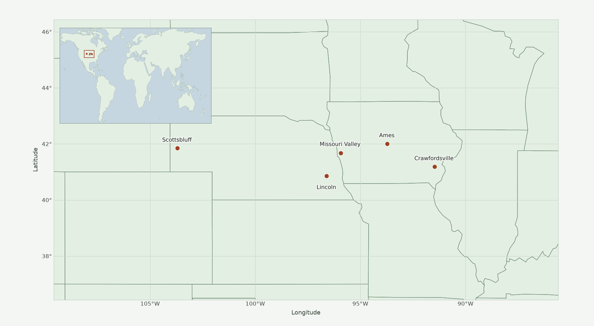

# UAV Crop Foundation Model

**An open, growing pool of crop drone imagery, and a vision model that is retrained every time the pool grows.**

Drone flights over crops sit scattered across papers and data repositories, hard to combine and harder to compare. This project gathers them in one place, pretrains a model on everything gathered so far, and scores it on the same two questions after every addition: how water-stressed a crop looks, and which growth stage it is in.

**How it works**

1. **Pool.** Contributors register public UAV crop datasets. We vet each one and add it to a shared training pool.
2. **Pretrain.** [DINOv2](https://github.com/facebookresearch/dinov2) is pretrained, self-supervised, on the full pool.
3. **Score.** Frozen features are scored with a linear probe on fixed, held-out water-stress and growth-stage sets. The checks never change, so every point on the graph is comparable.

## Where the images were flown

<!-- ucfm:coverage:start -->


_Each dot is a field site listed in `datasets/registry.yaml`. The frame follows the sites._
<!-- ucfm:coverage:end -->

## Tracking

<!-- ucfm:metrics:start -->


_Validation accuracy of a linear probe on frozen features, by number of images in the pretraining pool. Dashed line: DINOv2 before any pool pretraining. Updated 2026-09-29._
<!-- ucfm:metrics:end -->

## Contribute a dataset

**We welcome contributions.** If you have flown crops, or know of a public UAV crop dataset, adding it grows the pool and adds a pin to the map. You do not need to train anything.

**What we look for**

- Drone (UAV) imagery of crops, any crop and any country
- A license that allows training and attribution
- Field coordinates taken from the paper or the dataset
- A download link that resolves

**Where the files live.** If the dataset is already online (Dryad, Zenodo, Mendeley, a lab page), use that link. If it is not, upload a `.tar` or `.zip` to the [contributions folder](https://drive.google.com/drive/folders/1EPOM1KCEt47YjAmzW0HDTmgmQsTebmal?usp=sharing) and use that folder link, with the archive name, as `source`.

**Steps**

1. Fork or branch from `main` with a name like `data/short-id`.
2. Add one entry to [`datasets/registry.yaml`](datasets/registry.yaml):

   ```yaml
   - id: short_unique_id          # stable name, used as the pool folder
     title: "Human-readable name"
     added: 2026-09-28
     added_by: your-github-handle
     source: "https://doi.org/10.0000/example"   # or the contributions-folder link + archive name
     license: "CC BY 4.0"         # as stated where the files are hosted
     crop: maize
     year: 2023
     sites:                       # one pin per field, coordinates in decimal degrees
       - name: Place, Region
         lat: 41.85
         lon: -103.70
   ```

3. Redraw the map. It reads the registry, so you never place the dots by hand:

   ```bash
   git clone https://github.com/biomeandbyte/ucfm.git && cd ucfm
   pip install -e .
   ucfm render-map
   ```

4. Commit `datasets/registry.yaml` and `assets/coverage.png`, and open a pull request.

Do not commit images, archives, or cloud keys. Leave out sites whose images are not in the files you link.

**After you open the pull request,** we check the link, the license, and the pins. Once merged, we download the files, add them to the pool, and sync storage. The next training run includes your data, and the tracking graph gains a point.

## Checkpoint

The latest pool-pretrained DINOv2 weights:

```
s3://biomeandbyte-uav-continual-learning/checkpoints/dinov2_continual.pt
```

```bash
aws s3 cp s3://biomeandbyte-uav-continual-learning/checkpoints/dinov2_continual.pt .
```

```python
import torch
from transformers import Dinov2Model

ckpt = torch.load("dinov2_continual.pt", map_location="cpu", weights_only=True)
model = Dinov2Model.from_pretrained(ckpt["dinov2_model"])   # facebook/dinov2-base
model.load_state_dict(ckpt["model"], strict=False)
model.eval()
```

The checkpoint is replaced after each training run, so it always matches the rightmost point on the tracking graph.

Running the pipeline yourself (storage layout, SageMaker, CLI): [`docs/OPERATIONS.md`](docs/OPERATIONS.md).

## Acknowledgement

This pool exists because of the researchers who published their drone imagery openly. Each dataset is credited through its `source` in [`datasets/registry.yaml`](datasets/registry.yaml); please cite those datasets alongside this project.

If you use the model or the pool, please cite the preprint:

```bibtex
@misc{ucfm2026,
  title  = {UAV Crop Foundation Model: A Growing Pool of Crop Drone Imagery for Vision Pretraining},
  author = {Placeholder, Author},
  year   = {2026},
  note   = {Preprint forthcoming}
}
```
