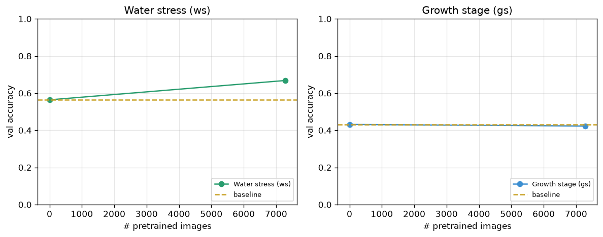

# UAV Crop Foundation Model (v1)

Continually grow a **vision foundation model** for crop UAV imagery by pooling manually curated public datasets, pretraining **DINOv2** on that pool, and measuring impact on two frozen downstream tasks:

| Task | What it measures |
|------|------------------|
| **ws** (water stress) | Can the model distinguish drought stress levels? |
| **gs** (growth stage) | Can the model distinguish vegetative/reproductive stages? |

**v1 is not agentic.** People find papers, download data, and upload to S3. Git triggers GPU training on **AWS SageMaker**. Results are tracked in this README.

---

## Results

<!-- ucfm:metrics:start -->
_Updated 2026-09-27 04:47 UTC. Dashed gold = baseline (DINOv2, no pool pretrain)._

| # pool images | ws (val acc) | gs (val acc) | note |
|--------------:|-------------:|-------------:|------|
| 0 (baseline) | 0.564 | 0.431 | no pool pretrain |
| 7281 | 0.668 | 0.423 | after pretrain steps=200 |


<!-- ucfm:metrics:end -->

Dashed gold line in the chart = **baseline** (DINOv2 ImageNet weights, no pool pretrain). Curves show val accuracy vs number of images in the pretraining pool.

---

## What v1 does

1. **Pool UAV crop images** from manually sourced datasets (papers, Zenodo, Mendeley, etc.)
2. **Pretrain DINOv2** on the growing pool (self-supervised)
3. **Linear probe** on frozen **ws** and **gs** eval splits after each pool update
4. **Log metrics** to S3 and update the chart/table above
5. **Track whether more data helps** — the core research question for v1

### In scope (v1)

- S3 as the data hub (`eval/`, `pool/`, `logs/`, `checkpoints/`)
- Multi-person upload via IAM groups
- `datasets/registry.yaml` as the training trigger (merge to `main`)
- Two GitHub workflows: **Start SageMaker training** (does not wait) and **Publish metrics** (manual chart update)
- SageMaker GPU training (`ml.g4dn.xlarge` or similar)
- Baseline run (no pool pretrain) for comparison lines on the chart

### Out of scope (v1)

- Automated paper discovery / download bots
- CLIP or multi-model training
- Fine-tuning eval heads (linear probe only)
- Production deployment or inference API
- Incremental/continual pretrain from checkpoint (v1 retrains on full pool each time)

---

## Architecture

```
┌─────────────────┐     upload      ┌──────────────────────────────┐
│  Team members   │ ──────────────► │  S3: biomeandbyte-uav-...    │
│  (IAM users)    │                 │    eval/   (frozen)          │
└─────────────────┘                 │    pool/<id>/...  (grows)    │
        │                           │    logs/   checkpoints/      │
        │ PR: registry.yaml         └──────────────┬───────────────┘
        ▼                                          │
┌─────────────────┐         create-training-job    │ read / write
│ Start workflow  │ ───────────── (exits) ───────► │
└─────────────────┘                                ▼
                                     ┌──────────────────────────────┐
                                     │  AWS SageMaker Training Job  │
                                     │  ucfm baseline or ucfm train │
                                     └──────────────┬───────────────┘
                                                    │ logs/ when the script finishes
                                                    ▼
┌─────────────────┐      you run this later      ┌──────────────────┐
│ README chart    │ ◄── Publish workflow ─────── │  S3 logs/        │
└─────────────────┘                              └──────────────────┘
```

**GitHub Actions does not train and does not wait.** **Start SageMaker training** calls `create-training-job` and exits. SageMaker can run for days. **Publish metrics** is a separate manual workflow: it syncs `logs/` from S3, runs `ucfm update-readme`, and commits the README. If you publish while a job is still training, the chart shows the last finished run.

---

## S3 layout

```
s3://biomeandbyte-uav-continual-learning/
  eval/
    ws/{train,val,test}/{class}/*.jpg    # frozen — admin uploads once
    gs/{train,val,test}/{class}/*.jpg
  pool/
    <dataset_id>/                        # any image subdirs (not pool/*/raw/)
      rgb/...                            # or nested folders of jpgs
      meta.json                          # optional: source, license
  logs/
    baseline.json                        # ws/gs scores with zero pool images
    metrics.jsonl                        # one row per train run
  checkpoints/
    dinov2_continual.pt
```

---

## Team workflow

### Admin (one-time)

1. Create S3 bucket + IAM groups (`acl-data-contributors`, `acl-pipeline-admins`, `acl-github-actions`)
2. Upload frozen eval splits to `s3://…/eval/`
3. Run baseline on SageMaker (or locally) → `logs/baseline.json` on S3
4. Create SageMaker execution role + ECR training image
5. Add GitHub Actions secrets (see below)

### Contributor (each new dataset)

1. **Download** dataset manually (browser — publishers block bots)
2. **Upload** to S3:
   ```bash
   aws s3 sync ./extracted/ s3://biomeandbyte-uav-continual-learning/pool/<dataset_id>/ --profile acl
   ```
3. **Register** in `datasets/registry.yaml`:
   ```yaml
   datasets:
     - id: mendeley_hkbgh5s3b7
       added: 2026-08-30
       added_by: timi
       source: "https://data.mendeley.com/datasets/hkbgh5s3b7/1"
       license: "CC BY 4.0"
   ```
4. **Open PR** → merge to `main` → **Start SageMaker training** launches a job and exits
5. When that SageMaker job is **Completed**, run **Publish metrics** to refresh this README

---

## SageMaker training (v1)

### Training job flow

`sagemaker/train.sh` (already in the image) syncs `eval/` and, for training, `pool/` from S3, runs `ucfm baseline` or `ucfm train`, and writes `logs/` and `checkpoints/` back to S3. Set `UCFM_TASK=baseline` or `UCFM_TASK=train` on the job. Max runtime on the start workflow is 72 hours.

### Recommended instance

| Instance | GPU | Use case |
|----------|-----|----------|
| `ml.g4dn.xlarge` | 1× NVIDIA T4 (16 GB) | Default for v1 |
| `ml.g5.xlarge` | 1× A10G | Faster, higher cost |

Jobs stop automatically when the script finishes — you only pay for runtime.

### AWS resources needed

| Resource | Purpose |
|----------|---------|
| **S3 bucket** | Data, logs, checkpoints |
| **SageMaker execution role** | Training job read/write on bucket |
| **ECR repository** | Docker image with CUDA + `ucfm` |
| **IAM user `acl-github-actions`** | GitHub → `CreateTrainingJob` + S3 read |

### SageMaker execution role

IAM → Roles → Create → **SageMaker** → attach policy for your bucket:

```json
{
  "Version": "2012-10-17",
  "Statement": [
    {
      "Effect": "Allow",
      "Action": ["s3:ListBucket", "s3:GetBucketLocation"],
      "Resource": "arn:aws:s3:::biomeandbyte-uav-continual-learning"
    },
    {
      "Effect": "Allow",
      "Action": ["s3:GetObject", "s3:PutObject", "s3:DeleteObject"],
      "Resource": "arn:aws:s3:::biomeandbyte-uav-continual-learning/*"
    }
  ]
}
```

### GitHub Actions secrets

| Secret | Value |
|--------|--------|
| `AWS_ACCESS_KEY_ID` | `acl-github-actions` IAM user |
| `AWS_SECRET_ACCESS_KEY` | same |
| `AWS_DEFAULT_REGION` | `us-east-2` |
| `UCFM_S3_BUCKET` | `biomeandbyte-uav-continual-learning` |
| `SAGEMAKER_ROLE_ARN` | `arn:aws:iam::555179754021:role/ucfm-sagemaker-role` |
| `SAGEMAKER_IMAGE_URI` | `555179754021.dkr.ecr.us-east-2.amazonaws.com/ucfm-train:latest` |

Optional repository variable `SAGEMAKER_INSTANCE_TYPE` (default `ml.g4dn.xlarge`). Set it to an instance type whose training quota is at least 1.

Workflows:

1. **Start SageMaker training** (`.github/workflows/start-training.yml`) — on merge of `datasets/registry.yaml`, or manually with task `baseline` or `train`. Creates the job and exits.
2. **Publish metrics** (`.github/workflows/publish.yml`) — manual. Syncs `logs/` from S3, runs `ucfm update-readme`, commits the README and chart.

---

## Local development

```bash
git clone <repo-url>
cd uav_crop_foundation_model
python -m venv .venv && source .venv/bin/activate
pip install -e .
cp .env.example .env    # UCFM_S3_BUCKET + AWS keys
```

```bash
ucfm s3-check           # verify AWS access
ucfm sync-eval          # pull eval from S3
ucfm baseline           # run baseline locally (CPU/GPU)
ucfm sync-pool          # pull pool from S3
ucfm train              # full pretrain + eval (same as SageMaker)
ucfm update-readme      # refresh chart from logs/
```

Eval splits layout:

```
data/eval/ws/{train,val,test}/{1,2,3,4,5}/*.png
data/eval/gs/{train,val,test}/{V7,R1,R2,R3,R4,R5,R6,R7}/*.png
```

---

## CLI reference

| Command | Description |
|---------|-------------|
| `ucfm baseline` | DINOv2 ImageNet probe on ws/gs (no pool pretrain) |
| `ucfm train` | Pretrain on full pool + linear probe eval |
| `ucfm sync-eval` | Download `eval/` from S3 |
| `ucfm sync-pool` | Download `pool/` from S3 |
| `ucfm upload-eval` | Upload local eval to S3 |
| `ucfm s3-check` | Verify credentials and bucket prefixes |
| `ucfm registry` | Print registered datasets |
| `ucfm update-readme` | Regenerate chart + results table |

---

## IAM groups (multi-person)

| Group | Who | Can do |
|-------|-----|--------|
| `acl-data-contributors` | Researchers | Upload to `pool/*`, read `eval/*` |
| `acl-pipeline-admins` | You | Full bucket access, eval upload, baseline |
| `acl-github-actions` | CI only | S3 + SageMaker; keys in GitHub Secrets |

One IAM user per person. Never share access keys.

---

## v1 success criteria

- [ ] Baseline ws/gs scores logged (n_images = 0)
- [ ] At least one external dataset in `pool/`
- [ ] SageMaker training job runs end-to-end from registry merge
- [ ] README chart shows baseline + at least one post-pretrain point
- [ ] Second contributor can upload data and trigger a run without admin help

---

## Roadmap (after v1)

- SageMaker Pipeline or Step Functions for multi-stage jobs
- Spot instances for cost savings
- GitHub OIDC instead of long-lived AWS keys
- Optional CLIP branch
- Agent-assisted dataset discovery (separate repo)
